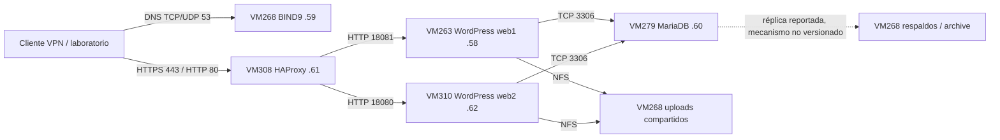

# Arquitectura E3 — cinco VMs

Estado reconstruido de `docs/ENTREGA3.md` en `279466d`, ramas integradas y evidencias del 20-10-2026. Las mejoras de esta auditoría son configuración propuesta, pendiente de despliegue.

Las direcciones `.58`–`.62` pertenecen a `10.33.199.56/29`; son cinco direcciones utilizables más el gateway observado `.57`. `.56` es red y `.63` broadcast. No queda una dirección libre para un sexto host en ese /29.

## Entrada y balanceo

BIND en `10.33.195.205` resuelve apex y `www` a **10.33.195.194**, interfaz administrativa del proxy. No es un salto del tráfico HTTP: DNS resuelve el nombre y el cliente conecta al proxy.

HAProxy publica 80→8080 y 443→8443, redirige HTTP a HTTPS y termina TLS autofirmado con SAN para ambos nombres. La auditoría propone mínimo TLS 1.2 y sustituir los encabezados de proxy enviados por el cliente. El tráfico proxy→backend y backend→DB no está cifrado por estas configuraciones; depende del aislamiento de la red de laboratorio.

`roundrobin` distribuye solicitudes sin afinidad. Los checks `HEAD /` con Host y `X-Forwarded-Proto: https` esperan 200; `inter 3s fall 3 rise 2`. Los intervalos sugieren detección del orden de segundos, pero **no constituyen un RTO medido**: influyen duración de conexión, timeout y carga. Un fallo común de DB puede retirar ambos backends.

## Estado y persistencia

| Componente | Persistencia/configuración | Consecuencia |
|---|---|---|
| web1 | `/srv/nodosur/web1/html` bind a `/var/www/html` | Core, plugins, temas y wp-config locales; deben mantenerse coherentes con web2 |
| web2 | `/srv/nodosur/web2/html` bind a `/var/www/html` | No se sincronizan automáticamente por Compose |
| uploads | `/srv/nodosur/nfs/uploads` en ambos, desde VM268 | Solo uploads compartidos; NFS es SPOF |
| MariaDB productiva | volumen histórico `nodosur-db-staging_db_stage_data` | Conservado explícitamente; no renombrar ni inicializar otro volumen |
| Respaldos DB | `/var/backups/nodosur/daily` en VM279; réplica a `archive` en VM268 reportada | Ruta absoluta remota, transporte y política de retención pendientes de captura |
| TLS | `/etc/nodosur/tls/haproxy-www.pem` en VM308 | Contiene clave privada; fuera del repositorio, lectura restringida |

Los Compose web usan la imagen **Apache** de WordPress; no se debe describir PHP-FPM nativo de E2 como runtime de E3. Un bind con una instalación existente prevalece sobre el código incluido en la imagen: el tag no certifica la versión efectiva de WordPress/plugins.

La coherencia de sesiones requiere DB compartida, prefijo de tablas común, salts idénticos y configuración HTTPS correcta. El carrito probado demuestra un flujo concreto; no acredita todos los plugins, sesiones autenticadas ni checkout concurrente. Los archivos PHP subidos se bloquean mediante una configuración Apache añadida en esta rama, pendiente de validación en contenedor.

## Control de arranque

La propuesta usa `/opt/nodosur` propiedad de root para Compose y configuraciones ejecutadas por systemd. Docker debe iniciar antes del firewall y el firewall antes del servicio publicado. Los web requieren NFS y un prechequeo de tipo, origen y RW; un directorio local no sirve como reemplazo silencioso.

`PartOf=docker.service` propaga un reinicio de Docker a los servicios asociados; su comportamiento debe probarse en laboratorio. `RequiresMountsFor` ordena el arranque, pero no resuelve una interrupción posterior del servidor NFS. Un montaje `hard` puede bloquear I/O durante esa interrupción.

`Type=oneshot`, `RemainAfterExit=yes` y `restart: "no"` mantienen un único control de arranque. **active (exited) no demuestra que el contenedor siga vivo**. No hay supervisor de recuperación automática ante toda caída de contenedor; comprobar estado Docker y health checks. `--wait` solo espera salud cuando el servicio tiene healthcheck; web y proxy no lo tienen en Compose.

## Fronteras de seguridad y limitaciones

[La matriz de firewall](configs/firewall/README.md) distingue tráfico de host (UFW/INPUT) y puertos Docker (DOCKER-USER/FORWARD). Las reglas nuevas cubren el destino original del DNAT por cualquier interfaz y restringen DB a web1/web2. La excepción antigua `.59` se elimina en la propuesta y debe verificarse contra las dependencias reales.

No hay clúster de DB, segundo proxy, DNS secundario, NFS redundante ni monitoreo centralizado acreditado. VM268 concentra DNS, uploads y copia remota: perderla afecta varios servicios y el respaldo externo simultáneamente. No hay evidencia de copia fuera del laboratorio ni de restauración integral DB + uploads + configuración. La red privada no equivale a cifrado ni a autenticación NFS fuerte.

## Evolución histórica

E1 dejó referencias de CMS/web en VM268; el historial disponible no permite reconstruir por completo sus criterios o pruebas. E2 consolidó DNS VM268, web nativa VM263 y MariaDB nativa VM279, TLS en Apache y LV local para uploads. Las copias históricas se preservan en [docs/historia](docs/historia/README.md); E3 incorpora Docker, VM310, VM308 y NFS. No se atribuyen retrospectivamente componentes ni resultados a E1.
