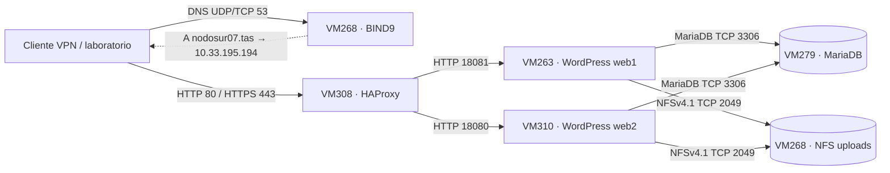

# Arquitectura de Nodo Sur — Entrega 3

**Estado implementado y comprobado al 21/10/2026.** Esta página describe el laboratorio en funcionamiento; no presupone que las modificaciones del PR de Codex estén instaladas.

## Vista general

**DNS no transporta solicitudes HTTP.** Resuelve el nombre para que el cliente contacte directamente con HAProxy. VM268 cumple dos funciones diferentes: DNS y servidor de archivos NFS; también aloja copias de respaldos.

## Inventario y tráfico

| Componente | IP administración | IP interna | Servicio |
|---|---|---|---|
| VM268 — DNS y NFS | `10.33.195.205` | `10.33.199.59` | DNS 53 UDP/TCP, NFSv4.1 TCP 2049 |
| VM263 — web1 | `10.33.195.202` | `10.33.199.58` | WordPress HTTP 18081 |
| VM310 — web2 | `10.33.195.208` | `10.33.199.62` | WordPress HTTP 18080 |
| VM279 — MariaDB | `10.33.195.226` | `10.33.199.60` | MariaDB TCP 3306 |
| VM308 — proxy | `10.33.195.194` | `10.33.199.61` | Entrada HTTP 80 y HTTPS 443 |

La subred interna es `10.33.199.56/29`. Los enlaces internos y el número de IPs disponibles limitan la ampliación directa sin modificar el direccionamiento. Ver [inventario](INVENTARIO.md) y [matriz de flujos](docs/MATRIZ-FLUJOS-E3.md).

## Capa de entrada: DNS, HAProxy y TLS

BIND9 resuelve `nodosur07.tas` y `www.nodosur07.tas` hacia `10.33.195.194`, dirección de publicación de HAProxy. En el host, Docker publica `10.33.195.194:80` y `:443` hacia los puertos internos `8080` y `8443` del contenedor.

HAProxy usa **roundrobin** entre web1 y web2, sin afinidad por cliente. Agrega `X-NodoSur-Backend` a las respuestas para identificar qué backend atendió cada solicitud. Los health checks son `HEAD /` con encabezado `Host: nodosur07.tas` y protocolo reenviado `https`; exigen **200**, con parámetros declarados `inter 3s fall 3 rise 2`. Estos intervalos no equivalen a un tiempo real de recuperación medido.

La redirección HTTP → HTTPS devuelve 301 a la URL principal. El certificado presentado es **autofirmado**, con SAN para los dos nombres y vigencia del 20/10/2026 al 20/10/2027. Se validaron sus datos públicos y `haproxy -c`. La confianza criptográfica del cliente no queda acreditada por conectarse mediante `curl -k`.

**Límite:** HAProxy termina TLS, pero la conexión HTTP hacia WordPress y el enlace a MariaDB no están cifrados explícitamente por esta configuración; se depende de la segmentación del laboratorio.

## WordPress y persistencia

Los dos hosts utilizan contenedores de imagen declarada `wordpress:7.1.2-php8.3-apache`. El sitio base de cada uno está en un directorio local bind-mounted:
- web1: `/srv/nodosur/web1/html` → `/var/www/html`.
- web2: `/srv/nodosur/web2/html` → `/var/www/html`.

Ambos montan `/srv/nodosur/nfs/uploads` → `/var/www/html/wp-content/uploads`, con `RW=true`. `findmnt` mostró NFSv4.1 desde VM268. Se comparó un mismo archivo descargándolo desde web1 y web2, y contra el original de NFS: **SHA-256 idéntico en los tres casos** ([evidencia](evidencias/e3/nfs-mismo-archivo-web1-web2-20261021.txt)).

**Solo `uploads` es compartido por NFS:** plugins, temas, core, `wp-config.php` y configuración Apache permanecen locales en cada web. El 21/10/2026 se detectó históricamente un desfase (web1 7.1.3, web2 7.1.2), **ya corregido** mediante actualización controlada del core de web2 con respaldo previo. La versión efectiva final verificada en ambos es **WordPress 7.1.3**, con `$wp_db_version = 61833`. Se comprobaron **9.817 archivos** idénticos por SHA-256 en los cuatro árboles `wp-admin`, `wp-includes`, plugins y temas ([comparación postactualización](evidencias/e3/comparacion-post-upgrade-web1-web2-20261021.txt)), además de archivos principales seleccionados de raíz, excluido `wp-config.php` ([evidencia](evidencias/e3/wordpress-raiz-sha256-igual-web1-web2-20261021.txt)). WooCommerce 11.1.0 coincidía en auditorías anteriores. **Esto no acredita igualdad de sesiones, salts ni toda configuración dinámica.** Docker Compose reproduce referencias a bind mounts, no sincroniza el contenido persistido; por eso la etiqueta de imagen `wordpress:7.1.2-php8.3-apache` continúa siendo distinta de la versión efectiva 7.1.3. A futuro se requiere un despliegue coordinado o artefactos inmutables, sin improvisar cambios antes de E3.

Los dos WordPress comparten MariaDB `10.33.199.60:3306`. El contenedor productivo todavía se llama **`nodosur-db-staging`** por motivos históricos; sus datos están en el volumen **`nodosur-db-staging_db_stage_data`**. Un cambio accidental de proyecto o volumen en Compose podría iniciar otra base vacía. [Prueba histórica de carrito](evidencias/e3/carrito-coherencia-postmigracion.txt): mismo carrito observado desde los dos web, sin probar checkout concurrente ni toda sesión autenticada.

## Control de servicios y seguridad

Cada VM Docker tiene su **propio archivo Compose y servicio systemd**. Esto **no es** Docker Swarm/Kubernetes ni un orquestador multiservidor. Los Compose productivos se validaron en VM263, 310, 279 y 308; se inspeccionaron los contenedores reales sin alterarlos.

En producción, systemd sigue leyendo el repositorio desde los `/home/USUARIO/nodosur-tas-grupo7` de cada VM, **no** desde `/opt/nodosur`. El despliegue propuesto por Codex bajo `/opt/nodosur` requiere migración revisada y no forma parte de la implementación actual. En web1 y web2 opera el servicio real **`nodosur-docker-firewall.service`**, activo y habilitado; reglas `DOCKER-USER` descartan orígenes distintos del proxy `10.33.199.61` para los puertos internos 18081 y 18080. Contadores observados: 4 paquetes DROP por backend ([reglas](evidencias/e3/firewall-docker-user-web1-web2-20261021.txt)).

`Type=oneshot` con `RemainAfterExit=yes` en systemd puede mostrar activo aunque un contenedor falle después; además las definiciones Docker observadas usan `restart: "no"`. Por eso la disponibilidad real se comprueba mediante contenedor, health check y solicitudes HTTP, no solo con `systemctl is-active`.

Las contraseñas, salts, certificados con claves privadas y `wp-config.php` real permanecen fuera de Git. En el equipo Fedora se ejecutó un escaneo **heurístico** de los archivos de la auditoría sin candidatos detectados; no es una garantía absoluta.

## Protección de los archivos compartidos (E3)

El directorio NFS `uploads` se comparte como datos, **no como un directorio autorizado para ejecutar PHP**. Se añadió a ambos contenedores WordPress la configuración Apache `configs/apache/nodosur-uploads.conf`, instalada en el host bajo `/etc/nodosur/apache/` y montada en solo lectura hacia `/etc/apache2/conf-enabled/nodosur-uploads.conf`. Deniega archivos PHP/PHTML/PHAR, CGI y listado de directorios en esa ubicación.

Primero se validó en un contenedor efímero aislado (archivo de texto existente `200`, PHP inocuo existente `403`). Después se recreó **web2 y, una vez comprobado, web1**. En ambos permanecieron accesibles portada, tienda e imagen compartida (`200`); una URL PHP inexistente bajo uploads obtuvo `403`. El proxy siguió entregando seis respuestas HTTPS `200` en reparto `3/3`. [Evidencia](evidencias/e3/apache-uploads-web1-web2-final-20261021.txt).

Esta protección es preventiva y no equivale a afirmar que se haya encontrado malware o demostrado una vulnerabilidad explotable. La continuidad funcional completa del checkout no se ha probado aquí.

## Tolerancia a fallos: alcance y limitaciones

La arquitectura permite que HAProxy retire del balanceo un **backend web** defectuoso y atienda con el otro. En la prueba controlada del 21/10/2026 se verificó el evento original **DOWN** de web2 y **8/8 respuestas HTTPS 200 desde web1** después de la detección ([evidencia](evidencias/e3/prueba-falla-web2-haproxy-web1-20261021.txt)). Tras recuperar web2, HAProxy registró **UP** por health check Layer7 HTTP 200 y se observaron **8/8 respuestas HTTPS 200, repartidas 4/4** ([evidencia](evidencias/e3/wordpress713-recuperacion-web2-haproxy-20261021.txt)). Esto demuestra continuidad tras detectar la falla y reincorporación automática, **no** ausencia de errores durante los primeros segundos ni RTO medido.

**SPOF pendientes:** hay una sola instancia de proxy, MariaDB, DNS y NFS. VM268 concentra DNS, NFS y una ubicación de respaldos. La caída de una dependencia compartida puede afectar a ambos WordPress; **balanceo no significa alta disponibilidad integral**. Tampoco se ha medido RPO/RTO ni ensayado un arranque funcional integrado del respaldo WordPress+DB.

## Evolución de E2 a E3

E2 utilizaba tres VMs con WordPress bajo Apache/PHP-FPM nativos y almacenamiento local. E3 conserva los roles de DNS y base de datos, pero migra los servicios web a Docker, incorpora web2 y HAProxy, y comparte uploads mediante NFS. Las decisiones de la etapa anterior siguen en el historial; no deben confundirse con la arquitectura actual.

De las medidas propuestas por Codex, **la restricción Apache de PHP en `uploads` sí se adaptó, comprobó e instaló en web1 y web2** y se documentó en el [PR #2 de cierre](https://github.com/camilodrn/nodosur-tas-grupo7/pull/2). Las demás propuestas de migración a `/opt/nodosur`, rediseño del firewall, saneamiento adicional de cabeceras del proxy y cambios de backup/staging permanecen en el [PR #1 de auditoría](https://github.com/camilodrn/nodosur-tas-grupo7/pull/1) **sin desplegar**.
